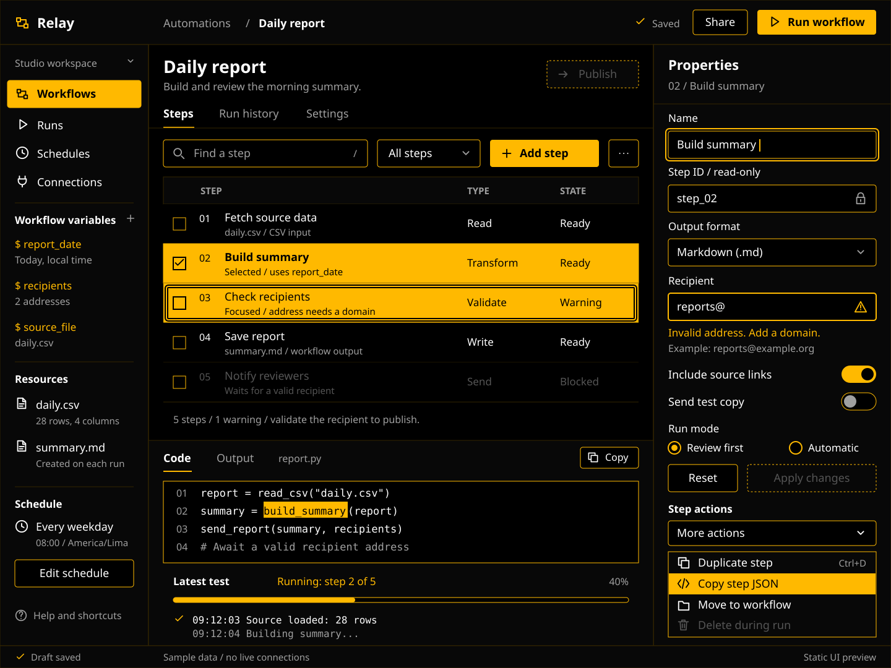

# Amber Black

High-contrast themes with pure black, white text, and `#FFB900` amber.

## Style guides

Amber Black keeps its original rules. The three selected guides define softer
dark profiles with amber-only UI colors and no light mode. Choose one complete
profile. These guides do not change the application themes.

[Style picker](style-guides/index.html) ·
[Implementation and state rules](style-guides/README.md) ·
[Concept notes and images](style-guides/amber-options/README.md)

| Amber Black | 01 Soft Amber |
| --- | --- |
|  |  |
| Pure black, white text, solid amber selection. | Warm charcoal, ivory text, soft amber cues. |
| [GitHub guide](https://github.com/Jamir-boop/amber-black/blob/main/amber-black-theme-style-guide.md) · [Full-size preview](style-guides/previews/amber-black.svg) | [GitHub guide](https://github.com/Jamir-boop/amber-black/blob/main/style-guides/soft-amber.md) · [Full-size preview](style-guides/previews/soft-amber.svg) |

| 02 Honey Graphite | 09 Honey Mist (dark) |
| --- | --- |
|  |  |
| Neutral graphite, warm text, muted honey gold. | Dark honey surfaces, cream text, restrained gold. |
| [GitHub guide](https://github.com/Jamir-boop/amber-black/blob/main/style-guides/honey-graphite.md) · [Full-size preview](style-guides/previews/honey-graphite.svg) | [GitHub guide](https://github.com/Jamir-boop/amber-black/blob/main/style-guides/honey-mist.md) · [Full-size preview](style-guides/previews/honey-mist.svg) |

## Themes

| Software | Theme source | Notes |
| --- | --- | --- |
| Claude Code | [`claude-code/amber-black.json`](claude-code/amber-black.json) | JSON token overrides |
| Codex CLI | [`codex-cli/amber-black.tmTheme`](codex-cli/amber-black.tmTheme) | TextMate syntax theme; see [`codex-cli/memory.md`](codex-cli/memory.md) |
| Firefox | [`firefox/`](firefox/) | Profile CSS theme with [installation instructions](firefox/README.md) |
| Global websites | [`global-userstyle/global-style.styl`](global-userstyle/global-style.styl) | Stylus userstyle with optional font and CRT settings |
| Global font | [`global-userstyle/global-font-only.styl`](global-userstyle/global-font-only.styl) | Font-only Stylus userstyle |
| Glow | [`glow/amber-black.json`](glow/amber-black.json) | Glamour JSON stylesheet for markdown rendering |
| micro | [`micro/amber-black.micro`](micro/amber-black.micro) | micro colorscheme |
| OpenCode | [`opencode-cli/amber-black.json`](opencode-cli/amber-black.json) | OpenCode JSON theme |
| Typora | [`typora/amber-black.css`](typora/amber-black.css) | Markdown editor theme with a block caret |
| WhatsApp Web | [`whatsapp/wsp.user.styl`](whatsapp/wsp.user.styl) | Stylus userstyle |

## Installation

See [installation instructions](INSTALLATION.md).

## License

Source code, configuration, and documentation are licensed under the MIT
License. Image and media assets (`.gif`, `.jpg`, `.png`, and `.svg`) are
excluded unless an asset states otherwise.
